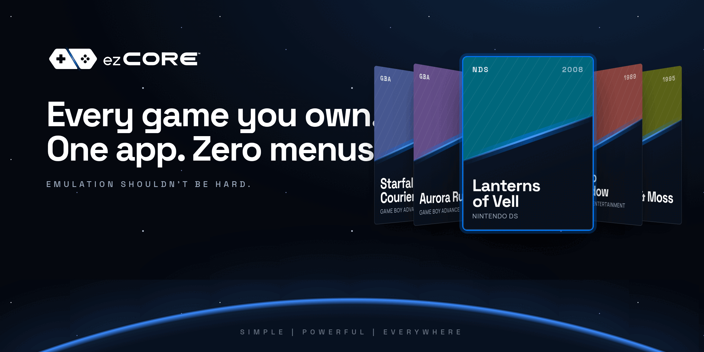
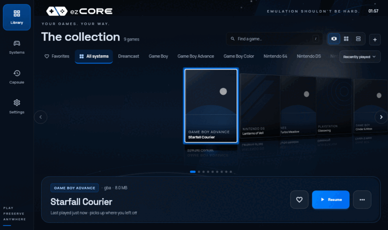
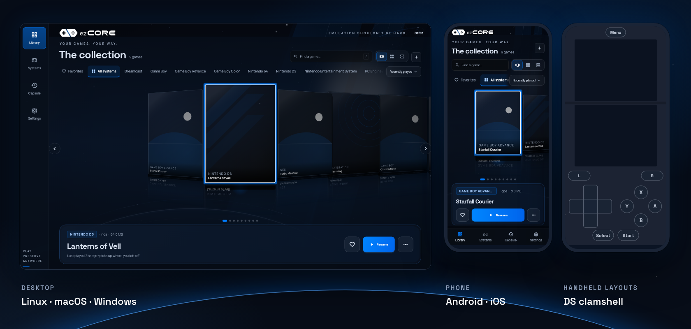
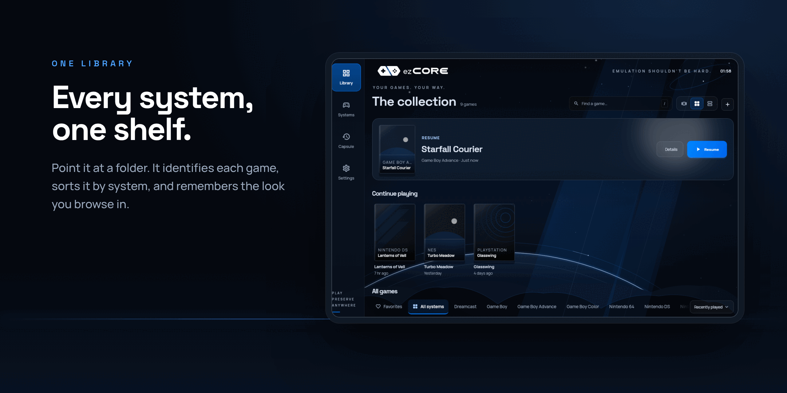
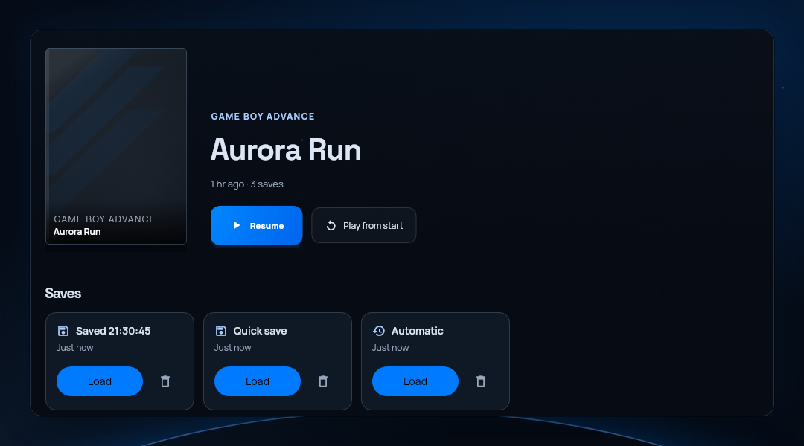
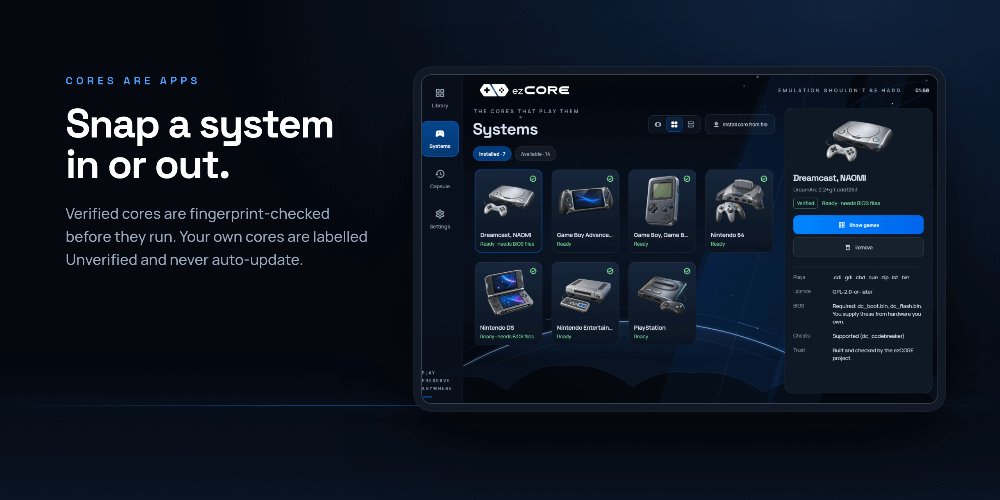

<p align="center">
  <a href="https://github.com/0xJ1nn/ezcore/releases/latest">
    
  </a>
</p>

<p align="center">
  <a href="https://github.com/0xJ1nn/ezcore/releases"></a>
  <a href="https://github.com/sponsors/0xJ1nn"></a>
  <a href="https://github.com/0xJ1nn/ezcore/stargazers"></a>
  <a href="LICENSE"></a>
</p>

<h3 align="center">The console-grade home for every game you own.<br>One beautiful app on every screen. Emulators install like apps.</h3>

<p align="center">
  <a href="#download"><b>Download</b></a> ·
  <a href="#why-ezcore">Why ezCORE</a> ·
  <a href="#take-the-tour">Tour</a> ·
  <a href="#the-lineup">Systems</a> ·
  <a href="#support-ezcore">Sponsor</a> ·
  <a href="#contributing">Contribute</a>
</p>

<p align="center">
  
</p>

## Why ezCORE

Emulation has never had a shortage of emulators. It has had a shortage of **calm**: a dozen apps, a dozen settings menus, a folder of saves you are afraid to touch. ezCORE is the front door that was missing.

<table>
<tr>
<td width="50%" valign="top">

### Play more. Struggle less.
Open the app and you are back in your last game, exactly where you stopped. Point it at a folder and every game is identified, sorted by system and put on the shelf. No core picking, no config files.

</td>
<td width="50%" valign="top">

### A UI worth looking at
A 3D shelf, real game pages, controller-first navigation from the first screen to the pause menu. It looks and feels like a console, because that is how games should feel.

</td>
</tr>
<tr>
<td valign="top">

### One app, every screen
The same library and the same experience on Linux, macOS, Windows, Android and iOS. Touch layouts are shaped per console, down to a two-screen DS clamshell.

</td>
<td valign="top">

### Emulators install like apps
Each system is a **core** you add or remove like an app. Official cores are built, fingerprinted and labelled **Verified**. Your own cores install from a file, and crash protection keeps a bad one from taking the app down.

</td>
</tr>
<tr>
<td valign="top">

### Your saves stay yours
Local-first. No account and no telemetry; the network is used only when you choose to download a core. Every save is a card you can load or delete.

</td>
<td valign="top">

### Build your own cores
Any emulator that speaks libretro can become an ezCORE core: package it, share it under your own name, and pick any licence you like. The [Core Module Exception](LICENSE-EXCEPTION.md) keeps the core ecosystem open to everyone.

</td>
</tr>
</table>

<p align="center">
  
</p>

## Take the tour

### Your whole library, one shelf
Add a file or drop in a folder. ezCORE recognises each game and the core that plays it, then gives you search, per-system filters, favourites and a *Continue playing* rail. Prefer a wall of covers? Switch the shelf to **Grid** or **List**, and ezCORE remembers.

<p align="center"></p>

### A real page for every game
Art, a **Resume** button, every save as a loadable card, cheats, and the honest details: which core plays it and where the file lives.

<p align="center"></p>

### Cores that snap in and out
The **Systems** screen is your app store for emulators: what is installed, what it plays, its licence, which BIOS files it needs, and whether the project built and checked it.

<p align="center"></p>

### Built for controllers and couches
Remap any button by pressing it. Hold **Select + Start** for a pause menu with save, load, cheats, fast-forward, screenshot and controls. The d-pad drives every screen: **A** confirms, **B** goes back. On touch screens, drag, resize, fade or hide any button and save the layout per system.

## The lineup

ezCORE hosts the best open-source emulators through the [libretro](https://www.libretro.com/) standard and polishes everything around them. Every status below is **verified, not aspirational**: "Boots and saves" means the core loaded real content, drew frames and survived a save-state round trip on the named platform. Evidence: [`docs/MATRIX.md`](docs/MATRIX.md).

| System | Core | Status |
|---|---|---|
| Game Boy / Game Boy Color | PocketBit (SameBoy) | Boots and saves · Linux, macOS |
| Game Boy Advance | AdvanceBit (mGBA) | Boots and saves · Linux, macOS |
| NES / Famicom | NesByte (Mesen) | Boots and saves · Linux |
| PlayStation | Geometry1 (SwanStation) | Boots and saves · Linux |
| PlayStation 2 | DualVU (Play!) · LRPS2 (PCSX2) | Boots and saves · Linux. DualVU needs no BIOS; LRPS2 uses your own dump |
| Nintendo DS | DualScreen (melonDS) | Boots and saves · Linux |
| Nintendo 64 | RCP64 (Mupen64Plus-Next) | Boots and saves, software renderer · Linux |
| PC Engine · Atari 2600 · Saturn | CardCon · Joystick · TwinSH | Verification in progress |
| DOS · SCUMM adventures | RealMode (DOSBox Pure) · PointClick (ScummVM) | Verification in progress |
| PSP · Dreamcast · GameCube / Wii | PortComp · DreamArc · PowerCube | GPU rendering in progress |
| Super Nintendo · Genesis · Arcade | SuperFX · BlastProc · CoinBox | Build your own: their licences forbid redistribution |
| 3DS · Switch | — | Held by project policy |

> ezCORE ships **no games, BIOS files or keys**. It is the shelves, not the discs. System names describe compatibility only; the marks belong to their owners ([`TRADEMARKS.md`](TRADEMARKS.md)).

## Download

| Platform | Get it | Status |
|---|---|---|
| **Linux x64** | [Build from source](docs/BUILDING.md) · release archive with the next release | Runs and is tested here |
| **Android arm64** | [Latest release](https://github.com/0xJ1nn/ezcore/releases/latest) `.apk` | Builds; on-device testing continues |
| **macOS arm64** | [Latest release](https://github.com/0xJ1nn/ezcore/releases/latest) `.zip` | Ran at v0.1.1; the current build is not yet re-verified |
| **Windows x64** | [Build from source](docs/BUILDING.md) | Not yet verified |
| **iOS** | [Build guide](docs/BUILDING.md) | Not yet verified (Apple only allows cores built into the app) |

Official builds come from this repository's [Releases](https://github.com/0xJ1nn/ezcore/releases) only. First launch, folders and BIOS placement: [`docs/INSTALL.md`](docs/INSTALL.md).

<details>
<summary><b>macOS first launch</b></summary>

Releases are ad-hoc signed and may not be notarised. If macOS blocks the app, right-click it and choose **Open**, or run:

```bash
xattr -cr /Applications/ezCore.app
```
</details>

## What's next

Analog sticks, keyboard and mouse for every core · GPU rendering for PSP, Dreamcast, GameCube and faster N64 · crash protection on every platform · single-file shareable core packages · verified builds on every platform. Full plan: [`ROADMAP.md`](ROADMAP.md) · changes: [`CHANGELOG.md`](CHANGELOG.md).

## Support ezCORE

<p align="center">
  <a href="https://github.com/sponsors/0xJ1nn"></a>
</p>

ezCORE is free and open source, with no ads, no paywalled features and no data collection, ever. It is built by people, in the open, and sponsorship is what keeps it moving:

- **Hardware for testing:** every platform in the Download table becomes *Verified* on real devices.
- **Time:** GPU rendering, new cores, and verified builds on every platform.
- **Sponsors get early builds**, and **every sponsor is thanked by username in the release notes** (unless you ask to stay anonymous).

A star helps too: it is how other players find the project.

## Contributing

Every merged contribution is credited: **your GitHub username goes in the Credits section of the next release notes.** The most valuable help right now:

- A bug fix with a test that fails without it.
- A verification report from real hardware: Windows, macOS, Android or iOS.
- A core build, licence check or compatibility improvement.
- Freely licensed test content with clear provenance.
- Design work that gets the next person to **Play** faster.

Start with [`CONTRIBUTING.md`](CONTRIBUTING.md): one clear problem per pull request, the [CLA](CLA.md) once, and `git commit -s`. AI-assisted work is welcome when it is disclosed and reviewed. The project never accepts ROMs, BIOS files, firmware, keys or circumvention tools.

<a href="https://github.com/0xJ1nn/ezcore/graphs/contributors"></a>

<details>
<summary><b>Build from source</b></summary>

```bash
git clone https://github.com/0xJ1nn/ezcore.git
cd ezcore

scripts/build_core.sh --fetch-headers
scripts/build_runtime.sh linux        # or macos
EZCORE_PLATFORM=linux scripts/build_core.sh --tier-desktop
python3 scripts/build_catalog.py

flutter pub get
flutter analyze
flutter test
ctest --test-dir runtime/build-linux --output-on-failure

flutter run -d linux                  # or macos
```

Prerequisites and every platform: [`docs/BUILDING.md`](docs/BUILDING.md).
</details>

<details>
<summary><b>Under the hood</b></summary>

```
┌──────────── Flutter app (Dart) ─────────────┐
│ Library · Systems · Settings · Player        │
│ controls engine · saves · controller input   │
└───────────────┬──────────────────────────────┘
                │ C ABI (in-process, or a helper process with crash protection)
┌───────────────▼──────────────────────────────┐
│ ezCORE runtime (C11): sessions, video,       │
│ audio, input, options, save states           │
└───────────────┬──────────────────────────────┘
                │ libretro
┌───────────────▼──────────────────────────────┐
│ cores: verified or your own, one per system  │
└──────────────────────────────────────────────┘
```

Architecture: [`docs/ARCHITECTURE.md`](docs/ARCHITECTURE.md) · core authoring: [`docs/CORE_AUTHORING.md`](docs/CORE_AUTHORING.md) · package format: [`docs/PACKAGE_FORMAT.md`](docs/PACKAGE_FORMAT.md) · platform rules: [`docs/PLATFORM.md`](docs/PLATFORM.md).
</details>

## License and credits

- **App and runtime:** [GPL-3.0-only](LICENSE).
- **Your own cores:** any licence you choose, under the [Core Module Exception](LICENSE-EXCEPTION.md). See [`docs/LICENSING.md`](docs/LICENSING.md).
- **Official builds:** published only by the maintainer; they may include proprietary first-party cores, which may not be redistributed.
- **Contributing:** [CLA](CLA.md) plus DCO sign-off; AI assistance is disclosed ([`CONTRIBUTING.md`](CONTRIBUTING.md)).
- **Name and logo:** trademarks, not covered by any code licence. Forks use their own name, and official builds may not be mirrored or repackaged ([`TRADEMARKS.md`](TRADEMARKS.md)).
- **Cores:** each keeps its upstream licence; see its manifest and [`THIRD_PARTY_NOTICES.md`](THIRD_PARTY_NOTICES.md).
- **Fonts:** Space Grotesk and Manrope, [SIL Open Font License 1.1](assets/fonts/OFL.txt).

ezCORE stands on the work of the [libretro](https://www.libretro.com/) community and the open-source emulator ecosystem. Screenshots show invented titles with generated cover art. Security: [`SECURITY.md`](SECURITY.md) · help: [`SUPPORT.md`](SUPPORT.md).

<p align="center"><sub>ezCORE · every game you own, one app.</sub></p>
